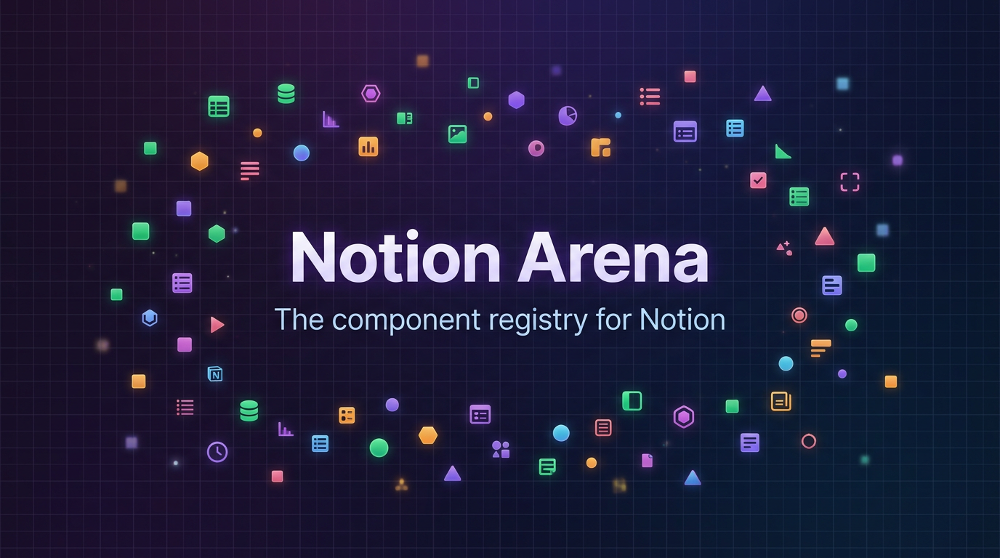
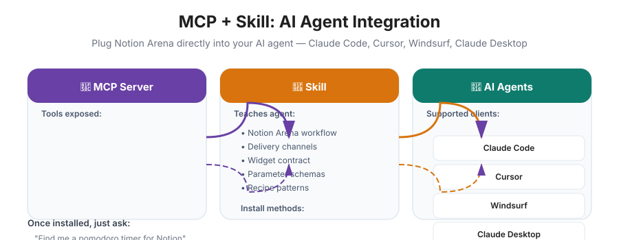
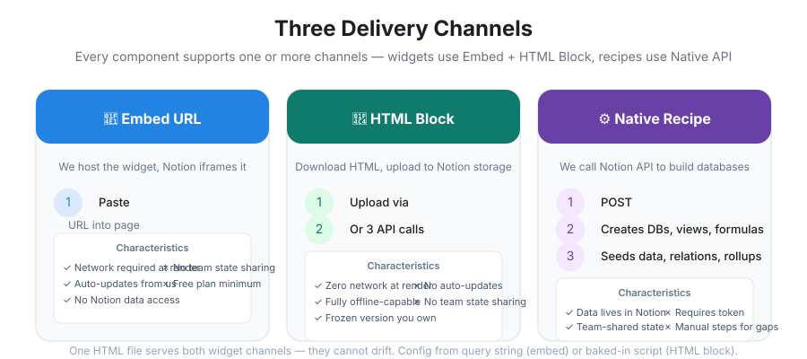

[](https://vercel.com/new/clone?repository-url=https://github.com/SynergyFlowLabs/notion-arena)
[](https://www.npmjs.com/package/notion-arena-mcp)
[](https://registry.modelcontextprotocol.io)
[](https://github.com/SynergyFlowLabs/notion-arena/blob/main/LICENSE)
[](https://github.com/SynergyFlowLabs/notion-arena/blob/main/CONTRIBUTING.md)
[](https://discord.gg/notion-arena)

# Notion Arena

<p align="center">
  
</p>

<p align="center">
  <strong>The component registry for Notion.</strong><br/>
  shadcn/ui's model: browse, configure, copy, own, install from code — applied to Notion dashboards.
</p>

<p align="center">
  
  
  
  
</p>

<p align="center">
  
  
  
  
  
  
  
  
</p>

---

## 🎯 What is Notion Arena?

Notion Arena is a **machine-readable component registry** for Notion — 167 pre-built components you can drop into any Notion page:

| | **156 Widgets** (Embed + HTML Block) | **11 Native Recipes** (Notion API) |
|---|---|---|
| **What** | Self-contained HTML files that run inside Notion | Database schemas, views, formulas, automations installed via API |
| **Delivery** | `<iframe>` embed or upload HTML file | `POST /api/install` with your token |
| **Network** | Required (embed) / None (HTML block) | None at runtime |
| **Data** | Browser-local only | Lives in your Notion workspace |
| **Team sync** | ❌ No | ✅ Yes |
| **Updates** | Auto (embed) / Manual (HTML) | Re-run install |
| **Min plan** | Free | Free / Plus / Business |

> **Notion is a trademark of Notion Labs Inc.** This is an independent project and is not affiliated with or endorsed by Notion.

---

## 🎨 Popular Widgets Showcase

<p align="center">
  
</p>

| Widget | Category | Description |
|--------|----------|-------------|
|  **Pomodoro Timer** |  Time | Work/break cycles with progress ring, session counter, chime |
|  **KPI Strip** |  Dashboards | 4 metric tiles with sparklines, deltas, target rings |
|  **Habit Grid** |  Trackers | GitHub-style heatmap, streaks, 5-level intensity |
|  **Flip Clock** |  Dashboards | Split-flap clock, timezone, 12/24h, Notion typography |
|  **Meeting Notes OS** |  Docs | Template with agenda, notes, decisions, action items |
| **Goal Ring** |  Dashboards | Single-metric hero with milestones & progress ring |

<details>
<summary><strong>📦 All 156 Widgets (click to expand)</strong></summary>

| Category | Count | Examples |
|----------|-------|----------|
|  **Time** | 11 | Pomodoro, Breathing, Stopwatch, Countdown, Month Calendar, Date Calculator, Flip Clock, World Clock, Count-Up, Interval Timer, White Noise, Sunrise/Sunset, Sleep Duration, Family Calendar, Study Session Log, Daily Planner, Routine Checklist, Workout Tracker |
|  **Dashboards** | 9 | KPI Strip, Goal Ring, Year Progress, Moon Phase, Flip Clock, World Clock, Weekly Status Report, Sunrise/Sunset, Count-Up, Countdown, Month Calendar, Date Calculator, Stopwatch, Breathing Timer |
|  **Trackers** | 19 | Habit Grid, Water Tracker, Mood Tracker, Routine Checklist, Workout Tracker, Sleep Duration, Plant Care Log, Pet Care Checklist, Volunteer Hours Log, Media Watchlist, Reading Progress, Savings Goal, Net Worth Snapshot, Expense Tracker, Portfolio Tracker, Debt Payoff Tracker, Subscription Tracker, Billable Time Tracker, Attendance Register, Collection Catalog, Gear Database |
|  **Planning** | 30 | Mini Kanban, Eisenhower Matrix, Gantt Timeline, Weekly Planner, Trip Itinerary, Meal Planner, Grocery List, Packing List, Chore Checklist, Home Maintenance Log, Product Roadmap, Sprint Retrospective, User Story Map, OKR Weekly Check-in, Daily Planner, Wedding Seating Planner, Event Run of Show, Milestone Tracker, Incident Log, QA Test Run Log, Event Guest List |
|  **Business** | 46 | ROI Calculator, Budget Planner, Inventory Tracker, Local Intake Form, Ticket Queue, Asset Checkout, Subscription Tracker, Bill Splitter, Currency Converter, Quote Builder, CRM Pipeline, Sprint Tracker, Invoice Generator, Client Onboarding Tracker, Sales Follow-up Queue, Campaign Planner, Interview Scorecard, Pricing Tier Calculator, Customer QBR Prep, Freelancer Proposal Tracker, Fundraising Outreach Tracker, Vendor Register, Access Review Log, Invoice Status Tracker, Leave and Time-Off Log, Renewal Board, Escalation Tracker, Purchase Request Tracker, Equipment Inventory Log, Approvals Request Log, Helpdesk Intake Log, Editorial Calendar, Site Diary, Restaurant Reservation Log, Donor Relationship Log |
|  **Docs** | 36 | Citation Builder, Reading Tracker, Spaced Repetition, Flashcards, Vocabulary Trainer, Bookmark Library, Reading List, Assignment Tracker, Exam Planner, Research Log, Protocol Checklist, Idea Inbox, Manuscript Progress, Chapter Outliner, Character Bible, Submission Tracker, Podcast Episode Planner, Guest Prep Sheet, Episode Production Checklist, Lesson Plan Builder, Research Conference Planner, Changelog Builder, SEO Content Planner, Content Repurposing Tracker, Usability Findings Log, Scholarship Tracker, Podcast Show Notes Log, Listener Feedback Log |
|  **Visuals** | 5 | Org Chart, Whiteboard, Quote Card, Daily Quote Card, Film Shot List, Storyboard Shot Log |
|  **Automations** | 1 | Automation Starter Pack |

</details>

---

## ⚙️ Native Recipes (11)

<p align="center">
  
</p>

| Recipe | Tier | Creates | Plan |
|--------|------|---------|------|
| **CRM Pipeline** |  Pro | 3 DBs, 6 formulas, 5 views, 2 templates, 3 automations | Plus |
| **Sprint Tracker** |  Pro | 2 DBs, 4 formulas, 4 views, 1 template | Plus |
| **OKR System** |  Free | 2 DBs, 5 formulas, 3 views, 1 template | Plus |
| **Meeting Notes OS** |  Free | 2 DBs, 1 template, 2 buttons, 4 views, 2 automations | Free |
| **Content Calendar** |  Free | 2 DBs, 3 formulas, 5 views, 1 recurring template | Plus |
| **Invoice Generator** |  Pro | 3 DBs, 6 formulas, 1 template, 1 button, 3 views | Plus |
| **PARA Life OS** |  Pro | 5 DBs, 7 relations, 6 views, 3 templates, 1 dashboard | Plus |
| **Habit OS (native)** |  Pro | 2 DBs, 5 formulas, 4 views, 1 button, 1 recurring | Plus |
| **Client Portal** |  Pro | 3 DBs, 4 views, 1 synced block, 1 page, 2 automations | Business |
| **Job Tracker** |  Free | 2 DBs, 4 formulas, 4 views, 3 templates | Free |
| **Automation Starter** |  Free | 2 DBs, 12 automations, 6 buttons, 3 recurring, 4 formulas | Plus |

---

## 🤖 For AI Agents — MCP + Skill

Plug Notion Arena directly into your AI agent — **Claude Code, Cursor, Windsurf, Claude Desktop**.

### MCP Server
Gives your agent tools to list/search/configure/plan-install all 167 components:

```bash
# Claude Code (project scope)
claude mcp add --scope project notion-arena -- npx -y notion-arena-mcp

# Or pinned version
npx -y notion-arena-mcp@0.2.2

# Cursor — .cursor/mcp.json
# Claude Desktop — claude_desktop_config.json
# See docs/AGENT_SETUP.md for all clients
```

### Skill
Teaches your agent the Notion Arena workflow, delivery channels, widget contract:

```bash
# Via skills.sh (Vercel) — cross-agent
npx skills add SynergyFlowLabs/notion-arena --skill notion-arena

# Via Claude Code plugin marketplace
/plugin marketplace add SynergyFlowLabs/notion-arena
/plugin install notion-arena@notion-arena-marketplace

# Manual
cp -r skills/notion-arena .claude/skills/notion-arena
```

Once both are installed, just ask:
> *"Find me a pomodoro timer for Notion"*
> *"Add a CRM pipeline to my Notion"*
> *"I need a habit tracker that works offline"*

Your agent will use `search_components`, `get_component`, `build_embed_url`, `plan_install` automatically.

**MCP Tools**: `list_components`, `search_components`, `get_component`, `get_widget_schema`, `build_embed_url`, `plan_install`, `get_registry_item`, `get_install_guide`, `get_categories`, `get_site_info`

**Skill**: `skills/notion-arena/SKILL.md` + `.claude/skills/notion-arena/SKILL.md` + `.claude-plugin/plugin.json` + `.claude-plugin/marketplace.json`

<p align="center">
  
</p>

See **[`docs/AGENT_SETUP.md`](docs/AGENT_SETUP.md)** for MCP+Skill setup and **[`docs/DEPLOY_AND_PUBLISH.md`](docs/DEPLOY_AND_PUBLISH.md)** for free deployment (Vercel) + publishing MCP to npm & registry and Skill to skills.sh & plugin marketplace.

---

## 🏗️ Three Delivery Channels — Visualized

<p align="center">
  
</p>

| | **Embed URL** | **HTML Block** | **Native Recipe** |
|---|---|---|---|
| **What it is** | We host the widget, Notion iframes it | You upload the file to Notion's storage | We call the Notion API |
| **Install** | `/embed` → paste | `/html` → upload, or 3 API calls | `POST /api/install` |
| **Network at render** | Required | None | None |
| **Reads your Notion data** | No | No | It *is* the data |
| **State shared with team** | No | No | Yes |
| **Gets our updates** | Automatically | No. Frozen | n/a |
| **Min. plan** | Free | Free | Free |

> One HTML file serves both widget channels, so they cannot drift. Configuration comes from the query string on the hosted path and from a baked-in `<script id="bk-config">` on the downloaded path, because a sandboxed block has no URL.

---

## 📋 Widget Contract — The 4 Rules

Every widget in `public/widgets/` implements the same four rules. See [`/docs/authoring`](app/docs/authoring/page.tsx) for the full guide and checklist.

<p align="center">
  
</p>

| Rule | Description |
|------|-------------|
| **1. Zero External Requests** | No CDN, no webfont, no `fetch()`, no `@import`. The sandbox has no network — a remote asset is a blank block. |
| **2. Two Config Sources** | Baked-in `bk-config` script tag (priority 1), then `URLSearchParams` (priority 2). Only declared parameters survive; unknown keys dropped by `buildConfig()`. |
| **3. Theme & Accent on Every Widget** | `theme=auto\|light\|dark` sets `data-theme` on `<html>` and follows `prefers-color-scheme` when auto; `accent` writes `--accent`, with derived shades via `color-mix(in oklab, …)`. |
| **4. Namespaced State** | Widgets that save browser state use `notion-arena.<slug>.v1` and wrap storage access in try/catch. State stays in one browser, never syncs — shared trackers belong in native recipes. |

**Plus**: `body { overflow: hidden }` with `.wrap` managing its own scroll (one scrollbar, not two), a `prefers-reduced-motion` escape hatch, and clipboard exports that always also `console.log` the payload as a fallback.

---

## 🏃 Running It Locally

```bash
# Install dependencies
npm install

# Restore 13 design/dev skills into .agents/skills/
npx skills experimental_install -y

# Start dev server
npm run dev          # http://localhost:3000
```

**Requirements**: Node 22+, Next.js 16 (Turbopack), React 19, Tailwind v4, TypeScript.

```bash
# Type-check
npx tsc --noEmit

# Widget contract checks (offline HTML validation)
npm run check:widgets

# Contrast audit
npm run audit:contrast

# Production build
npm run build

# MCP server
npm run generate:mcp-catalog  # 143 components → mcp/src/data/catalog.json
npm run build:mcp             # build notion-arena-mcp
npm run dev:mcp               # run MCP server with tsx (stdio)
```

Set `NEXT_PUBLIC_SITE_URL` in production to `https://notionarena.vercel.app` so registry manifests emit absolute URLs for the right host. Without it, URLs are derived from the request's forwarded host, falling back to `https://notionarena.vercel.app` (or `http://localhost:3000` in local dev).

---

## 📁 Project Layout

```
public/widgets/*.html      the products: 156 self-contained HTML files
lib/catalog.ts             source of truth for all 167 components
lib/types.ts               component/param types + the 8 categories
lib/widget.ts              config coercion, injection, HTML rendering  (server)
lib/widget-url.ts          URL builders                                (browser-safe)
lib/notion/schema.ts       Notion API payload builders
lib/notion/installer.ts    executes plans against @notionhq/client
lib/recipes/               11 recipe declarations + planInstall()
lib/registry.ts            shadcn-compatible manifest generation
components/                site UI, catalog browser, configurator, docs prose
app/embed/[slug]/          framed, configured widget HTML
app/api/widget/[slug]/     the same HTML as a download
app/r/[name]/              registry: index.json, schema.json, {name}.json
app/api/install/           plan | embed | html-block | api
docs/RESEARCH.md           the research behind all of it
skills/notion-arena/       AI agent skill (workflow, channels, contract)
mcp/                       MCP server (tools for agents)
```

---

## 📦 The Registry (shadcn-compatible)

```bash
GET /r/index.json          the whole catalog
GET /r/{name}.json         one item, HTML or recipe JSON inline
GET /r/schema.json         JSON Schema of every widget's parameters
```

```jsonc
// mcp config / components.json
{ "registries": { "@notion-arena": "https://notionarena.vercel.app/r/{name}.json" } }
```

```bash
# see exactly what an install will do: no credentials, touches nothing
curl -X POST localhost:3000/api/install \
  -H 'content-type: application/json' \
  -d '{"component":"crm-pipeline","mode":"plan"}'

# then run it
curl -X POST localhost:3000/api/install \
  -H 'content-type: application/json' \
  -d '{"component":"crm-pipeline","mode":"api",
       "token":"'"$NOTION_TOKEN"'","parentPageId":"'"$PAGE_ID"'"}'
```

`mode: "plan"` requiring no token is deliberate: review the request sequence before authorising any write to your workspace.

---

## ⚠️ Two Things Worth Knowing

**A widget cannot read or write your Notion data.** Notion's HTML block sandbox has no network access and no bridge to its parent page. Widgets may keep user-entered personal state in this browser, but that state is not Notion data and is not shared. If a workflow needs workspace records, collaboration, permissions, or an audit trail, use a native database or recipe.

**Relations force a two-pass install.** Since Notion split databases from data sources, a `relation` property targets a `data_source_id` that does not exist until the target database has been created and read back. `planInstall()` therefore emits: create databases with base properties → read back each data source id → patch in relations → patch in rollups → patch in formulas → views → seed rows → pages → block bodies in chunks of 100.

Recipes also declare what they **cannot** do. Four real API gaps (no `button` block type, no automation endpoint, no recurring-template endpoint, no synced-block duplicates) appear as `manual[]` steps, each citing the limitation. A manual step whose reason is "it's easier by hand" is rejected.

---

## 🤝 Contributing

We welcome contributions! Whether it's a new widget, a native recipe, a bug fix, documentation, or an idea — here's how to contribute.

<p align="center">
  
</p>

### Quick Start for Contributors

1. **Open an Issue** — Discuss your idea first. Check for duplicates. Get maintainer feedback.
2. **Fork & Clone** — Create your branch: `git checkout -b feat/my-widget`
3. **Develop** — Follow the widget contract (see checklist below)
4. **Test** — Run all checks locally
5. **Pull Request** — Clear title, link issue, screenshots/GIFs, update CHANGELOG
6. **Review** — Maintainer review, CI checks, widget contract audit
7. **Merge** — Auto-deploy to Vercel, MCP catalog regenerates, available immediately

### Widget Authoring Checklist

Every widget must pass all checks before merge — see [`scripts/check-widgets.mjs`](scripts/check-widgets.mjs).

<p align="center">
  
</p>

### Adding a New Widget

1. Create `public/widgets/my-widget.html` (single HTML file, self-contained)
2. Add entry to `lib/catalog.ts` with all required fields:
   ```typescript
   {
     slug: "my-widget",
     name: "My Widget",
     emoji: "🎯",
     tagline: "One-line hook",
     description: "Full paragraph explaining what it does and why.",
     category: "time", // time | dashboards | trackers | planning | business | docs | visuals | automations
     kind: "widget",
     tier: "free", // free | pro
     tags: ["tag1", "tag2"],
     color: "blue", // red | orange | yellow | green | blue | purple | pink | brown | gray
     params: [
       { key: "param1", label: "Label", type: "number", default: 10, min: 1, max: 100 },
       { key: "theme", label: "Theme", type: "select", default: "auto", options: [...] },
       { key: "accent", label: "Accent", type: "color", default: "#2383e2" },
     ],
     features: ["Feature 1", "Feature 2"],
     useCases: ["Use case 1", "Use case 2"],
     capabilities: {
       interactive: true,
       offlineSafe: true,
       persistsLocally: false,
       writesToNotion: false,
       needsNetwork: false,
     },
   }
   ```
3. Run `npm run check:widgets` and `npm run typecheck`
4. Test in Notion (embed + HTML block)
5. Submit PR

### Adding a Native Recipe

1. Create recipe in `lib/recipes/my-recipe.ts` exporting `planInstall()` and schema
2. Add entry to `lib/catalog.ts` with `kind: "native"` and `recipe: "my-recipe"`
3. Run `npm run generate:mcp-catalog` and `npm run build:mcp`
4. Test with `mode: "plan"` then `mode: "api"`
5. Submit PR

### Code Style

- **TypeScript strict mode** — no `any`, explicit types
- **Tailwind v4** — utility-first, no custom CSS unless necessary
- **React 19** — server components by default, `'use client'` only when needed
- **Conventional Commits** — `feat:`, `fix:`, `docs:`, `chore:`, `refactor:`

---

## 📜 Honesty Policy

- No fabricated install counts, star counts, or customer logos
- Badges are qualitative (`new`, `popular`, `staff-pick`) and derived from the catalog
- Market numbers appear only where cited
- Capability claims are booleans in the catalog (`interactive`, `offlineSafe`, `persistsLocally`, `writesToNotion`, `needsNetwork`) exposed in the registry so an agent can filter on them instead of reading prose

---

## 📄 License

**MIT License** — see [`LICENSE`](LICENSE) for details.

Components you download are yours: modify them, host them, ship them in templates you sell. Free components carry no attribution requirement. See [`/legal/terms`](app/legal/terms/page.tsx).

---

## 🔗 Links

- **Live Site**: https://notionarena.vercel.app
- **MCP Package**: https://www.npmjs.com/package/notion-arena-mcp
- **MCP Registry**: https://registry.modelcontextprotocol.io
- **Documentation**: https://notionarena.vercel.app/docs
- **Research**: [`docs/RESEARCH.md`](docs/RESEARCH.md)
- **Agent Setup**: [`docs/AGENT_SETUP.md`](docs/AGENT_SETUP.md)
- **Deploy & Publish**: [`docs/DEPLOY_AND_PUBLISH.md`](docs/DEPLOY_AND_PUBLISH.md)
- **Contributing**: [`CONTRIBUTING.md`](CONTRIBUTING.md)
- **Changelog**: [`CHANGELOG.md`](CHANGELOG.md)

---

<p align="center">
  Made with ❤️ by <a href="https://github.com/SynergyFlowLabs">SynergyFlow Labs</a> and contributors
</p>

<p align="center">
  <a href="https://github.com/SynergyFlowLabs/notion-arena/stargazers">
    
  </a>
  <a href="https://github.com/SynergyFlowLabs/notion-arena/fork">
    
  </a>
  <a href="https://github.com/SynergyFlowLabs/notion-arena/issues">
    
  </a>
  <a href="https://github.com/SynergyFlowLabs/notion-arena/pulls">
    
  </a>
</p>